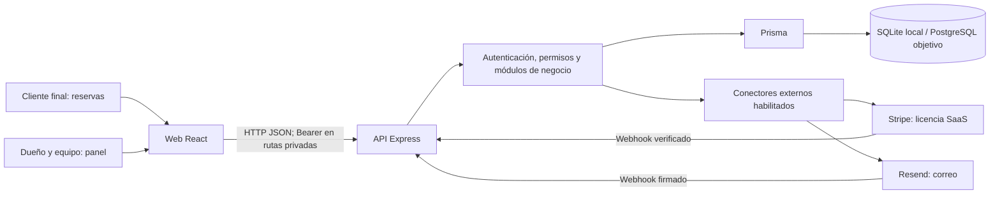

# SYSTECH Studio · Stack y arquitectura

Fecha: 8 de octubre de 2026. Documento basado en el código del repositorio y la evidencia local disponible. Describe el sistema actual y separa las decisiones de producción pendientes. No es una certificación de lanzamiento.

## Qué construimos

Un SaaS para barberías independientes y cadenas en México. Cada negocio utiliza una licencia y administra sucursales, equipo, agenda, clientes, inventario, ventas, caja y comisiones. El cliente final puede reservar desde una página pública; el dueño y los empleados utilizan un panel con permisos.

El problema que buscamos resolver es la operación dispersa entre libreta, mensajes y hojas de cálculo: citas encimadas, ventas sin registrar, diferencias de efectivo e incertidumbre sobre comisiones. Los resultados comerciales deben medirse con barberías piloto; todavía no se afirma un ahorro observado ni una tasa de conversión real.

## Stack actual

| Capa | Tecnología en el repositorio | Para qué se utiliza |
| --- | --- | --- |
| Interfaz web | React, TypeScript | Pantallas, formularios y estado de la interfaz |
| Navegación | React Router | Rutas públicas, acceso y panel |
| Construcción web | Vite | Desarrollo local y generación de archivos para despliegue |
| Presentación | Tailwind CSS, CSS propio, Lucide React | Estilos adaptables e iconos |
| API | Node.js, Express, TypeScript | Endpoints HTTP, permisos y reglas del negocio |
| Validación | Zod | Validación de entradas en los flujos que lo incorporan |
| Acceso a datos | Prisma | Consultas, transacciones y modelo de datos |
| Base local | SQLite | Desarrollo y pruebas con archivos/bases desechables |
| Base objetivo de producción | PostgreSQL | Datos relacionales y operación concurrente; migraciones y regresión ya probadas en entornos desechables |
| Autenticación | JWT Bearer, bcryptjs | Sesión firmada, verificación del usuario y hash de contraseñas |
| Controles HTTP | Helmet, CORS y límites de solicitudes del proyecto | Cabeceras, orígenes permitidos y protección de endpoints |
| Licencias | Catálogo compartido y conector Stripe | Planes, capacidad, checkout y eventos de facturación |
| Correo | Conector Resend, verificación Svix | Correo de cuenta y seguimiento de eventos firmados |
| Empaquetado | npm Workspaces; Docker y Compose | Monorepo y configuración de contenedores |
| Verificación | Scripts de integración, navegador automatizado y workflow GitHub Actions | Regresión, aislamiento, concurrencia y migraciones |

Las versiones exactas instaladas se fijan en `package-lock.json`; los `package.json` declaran rangos. El Dockerfile y el workflow actual usan Node 20, y Compose/CI contemplan PostgreSQL 16. Esa configuración existente debe revisarse por soporte y compatibilidad antes del despliegue; no se presenta aquí como una elección actualizada de versiones para producción.

Redis 7 aparece en Compose, pero no se encontró un cliente ni uso de Redis en `apps/api/src`. No forma parte de los flujos comprobados ni se justifica contratarlo todavía. Tener una dependencia o variable de entorno tampoco demuestra una integración operativa.

## Arquitectura actual

**Cliente web SPA + API como monolito modular + base relacional compartida.** Es una separación por responsabilidades y despliegue, no una arquitectura de microservicios.

Las reservas públicas tienen controles propios; no reciben permisos del panel. La API decide qué operación es válida, verifica la identidad y la capacidad del plan, y persiste los resultados. Ocultar un botón en React no sustituye la autorización del servidor.

Dentro de la API existen rutas y servicios por dominio: acceso/cuentas, sucursales, reservas, POS, inventario, caja, comisiones, clientes, reportes, licencias e integraciones. Hay lógica de negocio tanto en rutas como en servicios; es una organización modular en evolución, no una separación perfecta de todas las capas.

Las tareas programadas actuales se ejecutan con temporizadores dentro del proceso de la API. Los avisos de ventas se consultan periódicamente desde la web; no se debe describir este flujo como WebSocket. Antes de operar varias réplicas hay que revisar coordinación de tareas, límites de solicitudes y procesamiento de eventos para evitar ejecuciones concurrentes indebidas.

## Organización del repositorio

| Ubicación | Responsabilidad |
| --- | --- |
| `apps/web` | Aplicación React y cliente de la API |
| `apps/api` | Servidor HTTP, rutas, middleware, validadores y servicios |
| `packages/database` | Prisma, esquemas SQLite/PostgreSQL y migraciones |
| `packages/licensing` | Catálogo compartido de planes y reglas de capacidad |
| `scripts` | Desarrollo, pruebas, migración, restauración y utilidades |
| `docs` | Evidencia, decisiones, requisitos y seguimiento ágil |

## Modelo de datos y separación de negocios

La unidad de negocio es `Tenant`: la barbería o empresa contratante. Un tenant tiene sucursales y usuarios; cada sucursal organiza su operación. El modelo relaciona profesionales, productos/servicios, clientes finales, citas, ventas e items, comisiones y cortes de caja.

- Una venta registra tenant, sucursal, prestador, cobrador, importes, forma de pago y sus items. Puede vincularse a una cita; ese vínculo es único en el modelo.
- Una operación POS guarda una clave única por tenant y la venta resultante para recuperar reintentos.
- Los movimientos de inventario permiten seguir entradas/salidas. La custodia y entrega de efectivo tienen registros separados de la venta.
- Las suscripciones y el catálogo de licencias definen acceso/capacidad; no son las ventas de servicios de la barbería.

Se utiliza una base y un esquema compartidos para los negocios. El aislamiento se aplica en la autorización y el acceso a datos de la aplicación, con alcance por tenant y sucursal. No se afirma que cada cliente tenga una base propia ni que exista aislamiento por PostgreSQL RLS. Los esquemas separados usados por pruebas son una técnica de prueba, no el modelo comercial multiempresa.

## Flujo crítico: registrar una venta

1. La web envía los items, forma de pago y una clave de operación.
2. La API verifica sesión, negocio, sucursal, permisos y entradas; calcula/aplica las reglas del servidor.
3. El flujo transaccional conserva coherencia de venta, inventario, folio y registros financieros pertinentes. La clave única y los controles de concurrencia permiten recuperar el resultado original.
4. Si se pierde la respuesta después de guardar, la web conserva el intento para recuperarlo; no debe iniciar otro cobro. La unicidad depende del servidor y de reusar la misma operación, no solo de deshabilitar el botón.
5. El ticket se obtiene desde la venta guardada. Reimprimir no crea otra venta. El dueño consulta avisos de la operación.

El POS puede registrar efectivo, tarjeta, transferencia o pago mixto. **Registrar tarjeta no significa ejecutar un cargo bancario.** Stripe se utiliza para cobrar la licencia del SaaS; cobrar electrónicamente a los clientes de cada barbería es otro flujo que requiere definición e integración propias.

## Seguridad actual y límites

JWT firmado con algoritmo restringido; el middleware consulta el estado del usuario, su rol, tenant y versión de sesión. Permisos por rol y sucursal en servidor; sesiones revocables. Contraseñas mediante hash bcrypt, nunca como texto plano en la base. Secretos de producción mediante configuración del servidor, sin enviarlos a la web.

La web guarda el token en `localStorage`; esto tiene exposición ante XSS y merece una decisión explícita de seguridad antes de producción. No equivale a una cookie HttpOnly ni a inmunidad frente a scripts maliciosos. CORS tampoco sustituye autenticación. El aislamiento y las entradas se comprueban mediante pruebas; aún hace falta revisión operativa de HTTPS, acceso a infraestructura, logs, respaldos y datos personales.

Los comprobantes de venta no son CFDI. No se declara venta offline certificada, compatibilidad universal de impresoras, ESC/POS ni apertura de gaveta. El correo real, WhatsApp por negocio y facturación tienen criterios externos pendientes.

## Por qué esta estructura

Estas son razones técnicas que justifican mantener la estructura actual, no afirmaciones sobre la intención original de quien generó el código:

- TypeScript en web y API ayuda a detectar incompatibilidades al compilar; la validación del servidor sigue siendo necesaria.
- React permite reutilizar interfaz y adaptar el mismo panel a distintos tamaños.
- Express permite organizar los endpoints existentes con un backend único.
- Una base relacional encaja con ventas, items, citas y movimientos que deben conservar relaciones y consistencia.
- El monolito modular limita el número de servicios que hay que desplegar y operar durante el piloto. Puede dividirse después si mediciones y necesidades lo justifican.
- Un monorepo permite compartir el catálogo de licencias y conservar cambios, scripts y evidencia en el mismo proyecto.

## Estado comprobado

ST-01 a ST-09 están En revisión, pendientes de aceptación conjunta y criterios externos pertinentes. En la última regresión local: 13/13 suites en SQLite y PostgreSQL; comprobaciones de migración y conservación de base operativa. ST-09 incluye recorrido multiusuario y pruebas en tamaños emulados; no sustituye dispositivos o impresoras físicos.

La evidencia está en `docs/scrum/ST09_EVIDENCIA.md`, `docs/scrum/ST09_BROWSER_RESULTADOS.json` y las evidencias de cada historia. El workflow CI está configurado en `.github/workflows/postgres.yml`; su existencia no prueba que se haya ejecutado con éxito en el remoto. No se repitieron las suites para esta actualización documental.

## Decisiones pendientes para producción

| Decisión | Qué debemos concretar |
| --- | --- |
| Dominio y alojamiento | Proveedores, región, conexiones, HTTPS, presupuesto y condiciones reales; aún no contratados |
| PostgreSQL operativo | Instancia, tamaño, credenciales, migración ensayada y corte reversible |
| Respaldos y recuperación | Frecuencia/retención, pérdida de datos tolerable (RPO), tiempo de recuperación (RTO) y ensayo en infraestructura real |
| Supervisión | Errores, disponibilidad, logs sin secretos, alertas y responsable de soporte |
| Escalabilidad | Límites medidos con carga del piloto, conexiones de base y coordinación de tareas antes de agregar réplicas |
| Pagos de licencia | Cuenta/configuración real, webhooks y ciclo completo de renovación/cancelación; separación de sandbox |
| Correo | Dominio/remitente y entrega, rebote y supresión reales |
| Hardware | Al menos un modelo físico de 58 mm y uno de 80 mm; Sinhue aún no tiene impresora |
| Seguridad y privacidad | Almacenamiento de sesión, protección XSS, políticas, roles operativos y manejo de datos de clientes |
| Costos | Cotización de recursos esenciales y costo por negocio; evitar comprometer precios de proveedores sin verificarlos |

La forma de despliegue prevista es servir los archivos de la web, ejecutar la API como servicio y conectar PostgreSQL. Docker es una opción preparada; un proveedor concreto y su configuración no están aprobados aquí. No se contrataron servicios ni se desplegó con esta documentación.

## Cómo explicarlo al profesor

«Estoy construyendo un SaaS de operación para barberías, con una web React y TypeScript, una API Node.js y Express y acceso a datos con Prisma. Uso SQLite para desarrollo y tengo pruebas de migración y operación con PostgreSQL, que es la base objetivo para producción. La arquitectura es un monolito modular con datos compartidos y separación por negocio y sucursal en el servidor. Las operaciones críticas usan transacciones y claves de operación para recuperar reintentos sin repetir la misma venta. Trabajo por historias con evidencia; todavía faltan aceptación del piloto, infraestructura e integraciones y equipos reales».

Para sostener esa explicación, prepara una demostración de permisos, reserva vinculada a venta, entrega de efectivo y recuperación de errores. Si preguntan por capacidad o resultados económicos, presenta mediciones disponibles y pendientes; no inventes cifras.

La IA ha participado en la generación, modificación y verificación del proyecto. Sinhue define el problema, las reglas de operación, prioridades y revisión del producto. Conviene poder explicar y recorrer cada decisión, y describir honestamente qué fue asistido por IA y cómo se comprobó.

## Fuentes del repositorio

- `apps/web/package.json`, `apps/api/package.json`, `packages/database/package.json` y `package-lock.json`.
- `apps/api/src/index.ts`, `middleware/auth.ts`, `services/authorization.service.ts`, `services/cron.service.ts` y `routes/pos.routes.ts`.
- `apps/web/src/api.ts`, `packages/database/index.ts` y los esquemas de Prisma.
- `Dockerfile`, `docker-compose.yml`, `.github/workflows/postgres.yml` y evidencias ST-01 a ST-09.

Este documento debe revisitarse cuando cambien el alojamiento, la base de producción, los conectores o la arquitectura. Tiene prioridad la configuración comprobada y la evidencia fechada sobre comentarios del código que digan «production».
