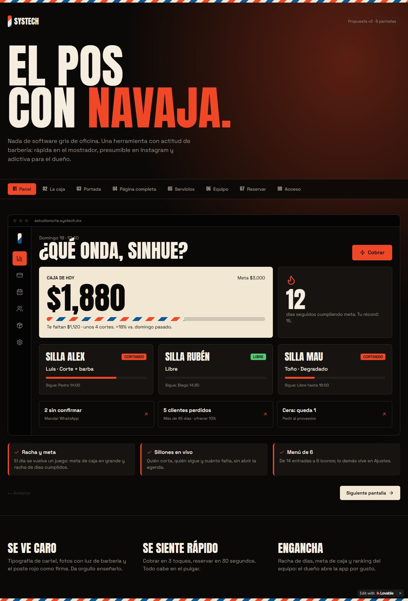
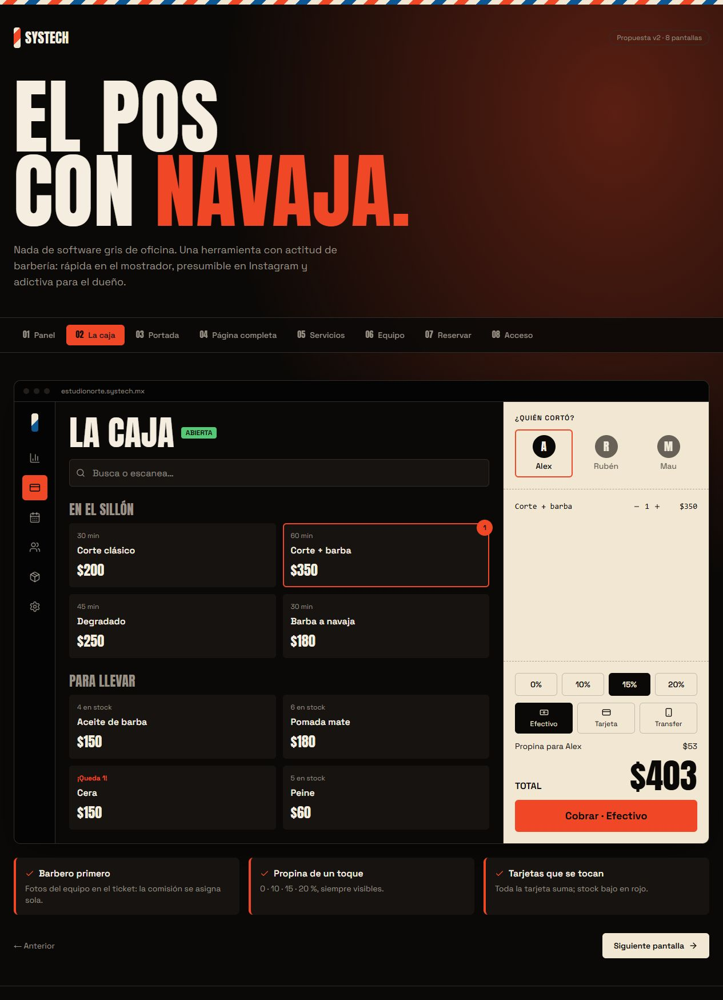
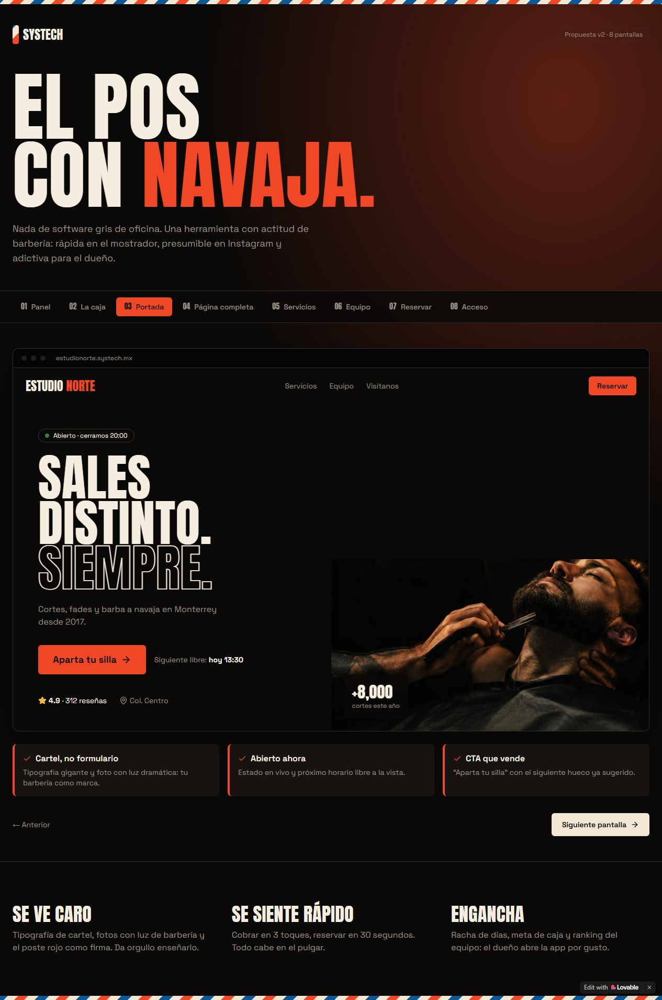
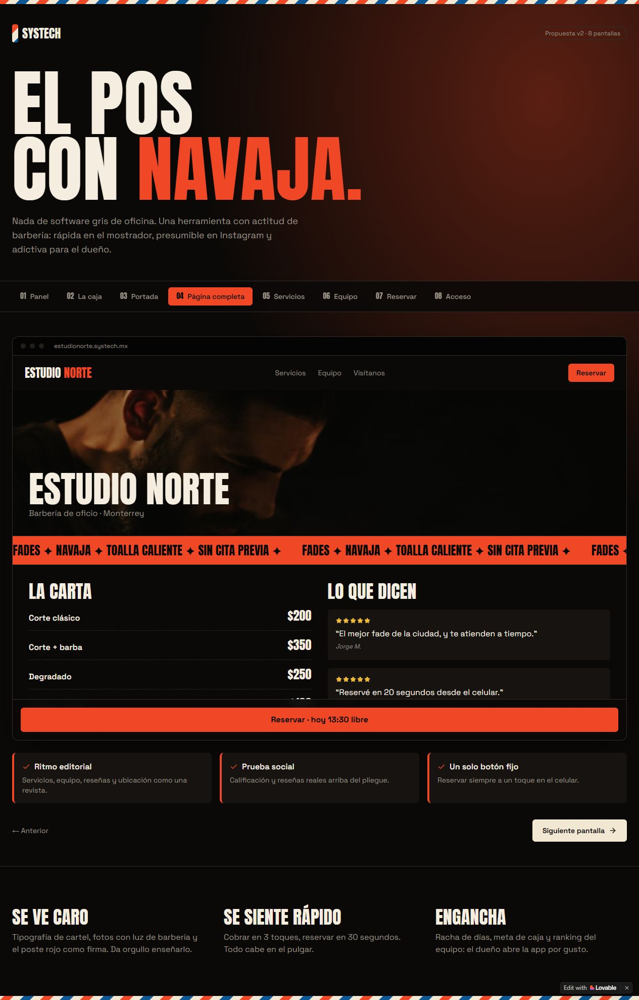
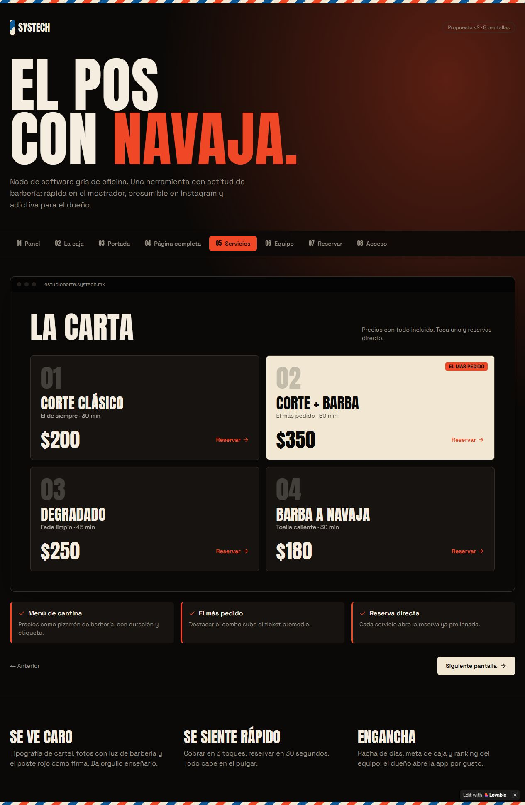
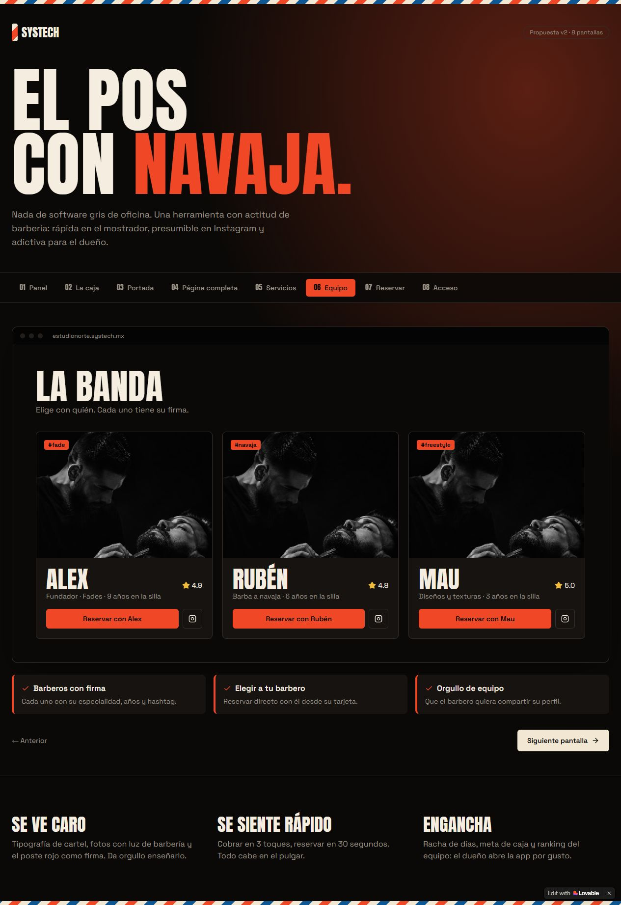
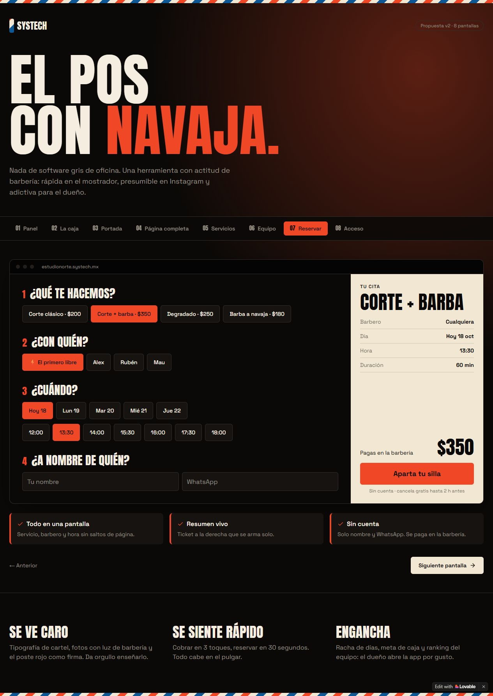
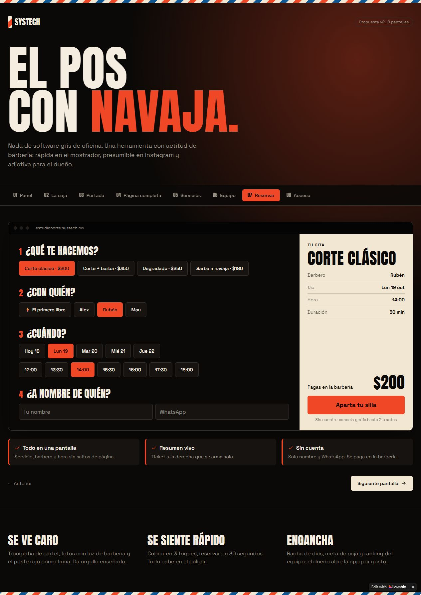
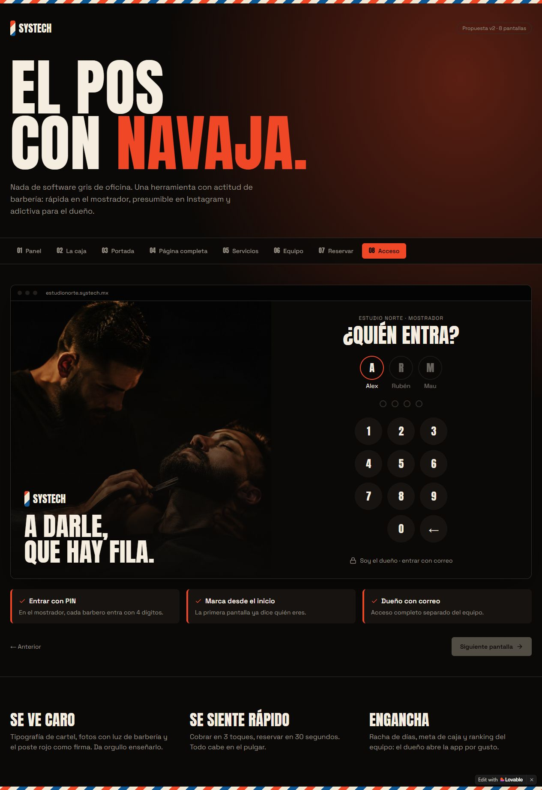

# Revisión de la propuesta de Lovable

Fecha: 18 de octubre de 2026. Proyecto: [Barber POS Studio](https://lovable.dev/projects/f77f535e-0d00-4f69-a3aa-991d443cee10). Revisión: b3b07ee4ba68422bfb59fe4dbce8e08e30f95298.

## Alcance y conclusión

Se recorrieron las ocho pantallas de la vista previa autenticada, se capturaron e inspeccionaron y se contrastaron interacciones con el código de src/routes/index.tsx. Es una propuesta visual interactiva con datos ficticios y estado local; no demuestra ventas persistentes, disponibilidad real ni autenticación operativa. No se modificaron Lovable ni el POS, ni se registraron cobros o reservas.

La dirección visual sí responde a la necesidad de personalidad: negro, hueso y rojo, tipografía de cartel, fotografía y detalles de barbería. Conviene adaptar esos recursos a nuestra aplicación, con mayor sobriedad en las pantallas de trabajo. No conviene reemplazar la lógica existente por este prototipo. No se midió conversión, rapidez de uso ni conformidad de accesibilidad; tampoco se completó una auditoría móvil.

## Ocho pasos revisados

1. **Panel — aprovechable con ajustes.** Las sillas ocupadas, la próxima cita y la acción Cobrar ayudan a entender la operación. La meta, racha y estadísticas son datos de ejemplo. La navegación solo con iconos necesita etiquetas y destinos funcionales. No mostrar metas o comparaciones inventadas.

2. **Caja — buen planteamiento visual; lógica insuficiente.** Catálogo oscuro y recibo claro separan selección y revisión. Cambiar a Rubén y 0% actualizó el resumen a $350 durante el recorrido. La selección inicial aplica 15% de propina; el código redondea $52.50 a $53. La propina debe ser una elección explícita y conservar centavos. El botón Cobrar solo cambia estado y vacía el carrito: no es una venta persistida. No se pulsó para simular una operación. Mantener pagos mixtos, cambio, permisos, devoluciones y trazabilidad de nuestra base.

3. **Portada — dirección visual fuerte.** Fotografía, mensaje y llamada a reservar dan carácter. Horario abierto, siguiente turno, reseñas y cifras están prefijados: deben proceder de configuración o datos reales. Ofrecer esta estética como tema personalizable por barbería.

4. **Página completa — aprovechable con ajustes.** Integra servicios, reseñas y una llamada persistente a reservar. El marco de presentación limita la vista de la página; falta verificar todo el desplazamiento y los solapamientos en un sitio real. La cinta animada debería respetar movimiento reducido. No publicar reseñas, ubicación o teléfono ficticios como información real.

5. **Servicios — clara; recorrido incompleto.** Precio, duración y combo destacado son fáciles de comparar. Al pulsar Corte clásico no se observó avance ni cambio de pantalla. El diseño debe conectar la selección con la reserva y conservar la selección de varios servicios. La etiqueta «más pedido» requiere datos; una recomendación editorial debe identificarse como tal.

6. **Equipo — buena jerarquía; contenido provisional.** Fotos grandes, especialidades y acción por barbero ayudan a elegir. Los tres perfiles repiten la misma fotografía y muestran experiencia/calificaciones ficticias. Usar fotos y datos autorizados o un avatar honesto; vincular cada acción con el profesional correcto.

7. **Reserva — resumen reactivo verificado; operación pendiente.** Elegir Corte clásico, Rubén, lunes 19 y 14:00 actualizó el resumen a 30 minutos y $200. Fechas y horarios están prefijados; no se comprueba disponibilidad. Los campos de contacto no tienen validación operativa y confirmar solo cambia estado local, incluyendo un mensaje de WhatsApp sin envío real. No se envió la reserva. Conservar validaciones, prevención de duplicados, persistencia, recuperación y preferencias del corte de nuestra aplicación. La política de cancelación debe ser configurable.

8. **Acceso — atractivo como concepto; no es autenticación.** La identidad del equipo y el teclado son comprensibles para un mostrador. El código muestra bienvenida al completar cuatro dígitos, sin verificar identidad; el acceso por correo es un control de presentación. Un futuro PIN de mostrador necesitaría sesión autorizada, verificación segura, límites de intentos, permisos y registro de actividad. No sustituir el inicio de sesión actual por este ejemplo.

## Prioridad de adopción

1. Tema público configurable con fotografía, tipografía expresiva y acentos de marca; mantener legibilidad y rutas de reserva reales.
2. Mejor jerarquía visual en caja: catálogo, selección y recibo claramente separados, conservando cálculos y controles actuales.
3. Panel operativo con estado de sillas y próximas citas, calculado con datos reales y navegación rotulada.
4. Perfiles de profesionales con fotos propias, especialidades y selección vinculada a la agenda.
5. Validar después escritorio y móvil, teclado, foco, contraste y tamaños táctiles con evidencia nueva.

No son evidencia de mejora las frases «cobrar en tres toques», «reservar en treinta segundos» o «engancha al dueño»: requieren pruebas con personas y tareas reales.
