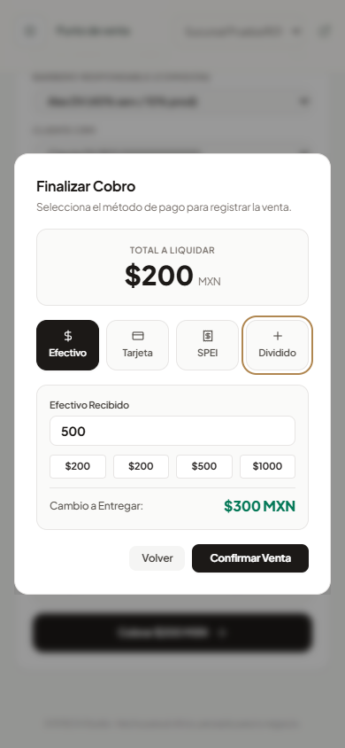
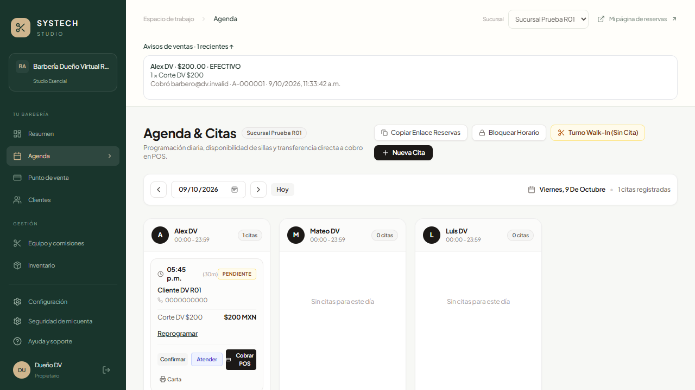
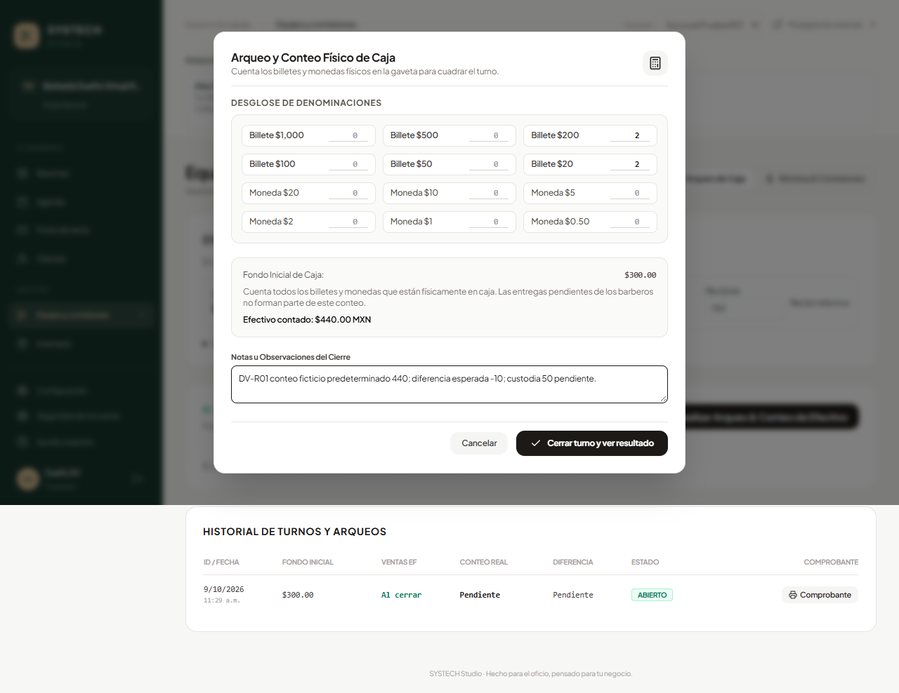
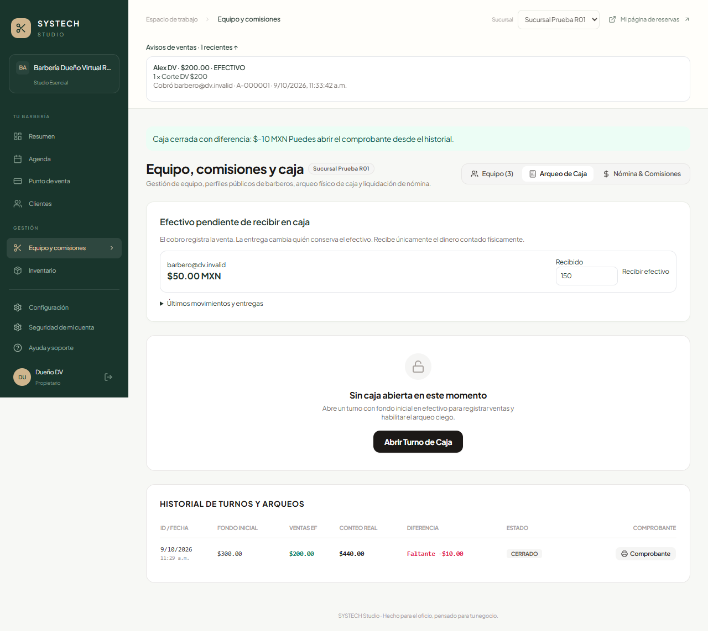
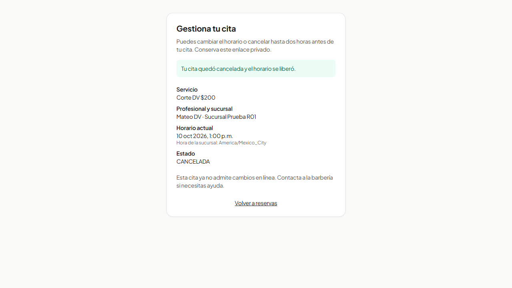

# Reporte del dueño virtual — DV-20261009-R01

## Actualización final de caja · 9 de octubre, 12:22

Los pendientes de revisión visual de CashCustody y Barberos se resolvieron con una segunda operación sobre la misma base desechable. Entrega adicional de $20 sobre saldo $50: el campo se actualizó a $30 al confirmar; no conserva el importe anterior. Segundo turno con fondo $0, entrega $20 y conteo ficticio $19: cierre con diferencia −$1, aviso ámbar observado en captura y DOM (`bg-amber-50 text-amber-900`, rgb(255,251,235)). Capturas 15/16 guardadas e inspeccionadas. Persistencia independiente conserva una venta $200 y una comisión $80; hay dos turnos cerrados, sin otra venta ni comisión. Evidencia: `DV_VALIDACION_FINAL_2026-10-09.json`.

Este agregado sucede después del recorrido histórico siguiente y no sobrescribe su prueba de un turno. La aceptación por historia se registra en `CIERRE_REVISION_ST01_09_2026-10-09.md`; hardware externo permanece pendiente.

Fecha: 9 de octubre de 2026. Ejecución iniciada por `dueno_virtual` y terminada por el coordinador tras agotarse la cuota del agente. IAB estuvo indisponible; se usó la alternativa Playwright en la app local. El registro del primer bloqueo se conserva en `DV_RESULTADOS_2026-10-09.md`.

**Resultado: recorridos principales y conciliación comprobados en simulación.** Datos ficticios, base SQLite desechable, API local y proveedores desactivados. No se asigna una lista de pruebas manuales a Sinhue. Sprint 2 conserva En revisión por sus criterios y pendientes externos.

## Recorrido realizado

1. Página pública: tres barberos visibles, servicio de $200 y duración de 30 minutos. Reserva anónima principal para Alex a las 17:00 del 9 de octubre.
2. Inicio de sesión del dueño: una cita y cero ventas; apertura de caja con fondo ficticio de $300.
3. Dueño reprograma principal a las 17:45. Agenda confirma hora y profesional.
4. Barbero accede con sesión separada y viewport móvil de 390×844; encuentra su cita y pulsa Atender. Estado EN_CURSO, no todavía COMPLETADA.
5. Cobrar POS conserva vínculo con cita/cliente, profesional Alex, servicio $200 y comisión del 40%.
6. Diálogo: Escape antes del envío cierra sin perder carrito; reapertura conserva venta de $200. Recibido $500, cambio $300. Tras corrección, 16 avances Tab y Shift+Tab permanecen dentro del diálogo.
7. Confirmar una vez: controles desactivados durante envío y ticket A-000001 por $200. La cita y venta quedan COMPLETADA; no se probó un fallo de red artificial.
8. Dueño recibe aviso en su página que permanecía abierta, sin recargarla: profesional, importe, medio, cobrador y folio correctos.
9. Dueño recibe $150 de los $200 bajo custodia del barbero. Pendiente visible $50; entregar no crea otra venta ni comisión.
10. Conteo ciego predeterminado: dos billetes de $200 y dos de $20 = $440. Cierre único: $450 esperados, diferencia −$10; historial conserva ese corte cerrado y pendiente $50 fuera de caja.
11. Segunda reserva pública para Mateo el 10 de octubre a las 12:00. Gestión mediante enlace privado: reprogramada a las 13:00; la agenda abierta del dueño cambia sin recarga tras la corrección.
12. Cancelar secundaria: confirmación y estado CANCELADA tanto en gestión pública como en agenda. Sin segunda venta. Esta secundaria se operó en una pestaña del contexto autenticado del dueño; la reserva principal sí fue anónima.

No se midió tiempo humano de cobro ni se certifica la promesa comercial de 30 segundos. Dos esperas del recorrido asumieron mensajes/estados distintos de los reales; se corrigió la observación antes de avanzar, sin registrar otro pago.

## Control independiente y persistencia

Los esperados se fijaron antes de actuar; no se copiaron del saldo del producto para construir el conteo.

| Magnitud | Esperado | Observado y persistido |
| --- | ---: | ---: |
| Venta / recibido / cambio | $200 / $500 / $300 | $200 / $500 / $300 |
| Comisión sin liquidar | $80 | $80 |
| Fondo inicial | $300 | $300 |
| Entrega / custodia pendiente | $150 / $50 | $150 / $50 |
| Caja esperada / contado | $450 / $440 | $450 / $440 |
| Diferencia ficticia | −$10 | −$10 |
| Ventas / cortes cerrados | 1 / 1 | 1 / 1 |
| Citas completadas / canceladas | 1 / 1 | 1 / 1 |

Comprobación separada sobre datos persistidos: `DV_PERSISTENCIA_2026-10-09.json`. Assert de vínculo cita/venta, cambio, comisión, corte y saldo de custodia aprobado. Hash de la base operativa idéntico antes/después del trabajo del coordinador. Las pruebas de concurrencia de inventario se ejecutaron en otra base.

## Hallazgos y correcciones

| Hallazgo | Impacto | Resultado |
| --- | --- | --- |
| Agenda del dueño mantenía PENDIENTE aunque recibía aviso de venta completada | P2: acciones basadas en información atrasada | Actualización de citas/bloqueos mientras está visible, con exclusión de respuestas antiguas; reprogramación y cancelación desde otra pestaña observadas sin recarga |
| Tab podía pasar del último control del cobro al cuerpo del documento | P2: orientación por teclado | Cierre explícito del ciclo de foco; reintento de 16 Tabs y Shift+Tab aprobado |
| Importe de entrega permanecía en $150 después de quedar $50 pendientes | P2: invita a un nuevo intento inválido | Se limpia solo el importe del usuario tras entrega confirmada; verificado por revisión de código y TypeScript, sin segunda entrega financiera en esta corrida |
| Aviso de caja con diferencia se mostraba verde | P2: señal visual ambigua | Advertencia ámbar cuando hay descuadre; revisión de código y TypeScript, sin generar otro corte solo para la captura |
| Recepción de compra podía aplicarse varias veces | P1: existencias incorrectas | Reproducido y corregido por backend; 6/6 pruebas dedicadas en dos procesos SQLite, evidencia separada |

## Capturas actuales

Todas guardadas e inspeccionadas individualmente en esta ejecución. Las capturas 10/11 preceden los dos ajustes visuales menores de entrega/advertencia; no se presentan como imágenes del aspecto final de esos ajustes.

- `01-reserva-inicio.png`: equipo y servicio públicos.
- `02-reserva-antes.png`, `03-reserva-confirmada.png`: datos ficticios y confirmación.
- `04-caja-abierta.png`, `05-agenda-reprogramada.png`: fondo y cita.
- `06-cobro-movil-antes.png`, `07-cobro-movil-viewport.png`: recibido/cambio; 07 muestra viewport emulado.
- `08-ticket-venta.png`, `09-aviso-dueno.png`: ticket y aviso sin recarga.
- `10-conteo-ciego.png`, `11-caja-cerrada.png`: conteo e historial.
- `12-gestion-reprogramada.png`, `13-agenda-actualizada.png`, `14-reserva-cancelada.png`: gestión y actualización entre pestañas.

Carpeta: `docs/scrum/evidencia/dv-20261009-r01`.

### Cobro en viewport móvil emulado

### Aviso en la sesión abierta del dueño

### Conteo predeterminado y resultado persistido

### Cancelación de la reserva secundaria

## Alcance de la evidencia

**Observado:** interfaces de reserva, atención, cobro, aviso, entrega, conteo/cierre y gestión; navegación móvil emulada; controles desactivados durante envío; teclado antes de enviar; persistencia de cifras.

**Inferido/revisión estática:** manejo de Escape durante envío y recuperación de resultado incierto conservan guardas/intención; pequeños ajustes de entrega/tono conservan reglas monetarias. No se afirma prueba de esas ramas durante una falla real.

**No comprobado aquí:** lectores de pantalla, teléfono/impresora físicos, reimpresión mediante hardware, operación bancaria, correo/WhatsApp entregados, producción, PostgreSQL con los arreglos nuevos, ni aceptación de clientes reales. Impresión tiene además siete pruebas técnicas de tickets aprobadas en SQLite, no una certificación física.

La compilación TypeScript web final aprobó. El empaquetado Vite final quedó pendiente: sandbox bloqueó resolución de archivo local y la elevación no se ejecutó porque la revisión automática de permisos agotó su cuota. No fue una determinación de que la acción era insegura ni se eludió la revisión.
