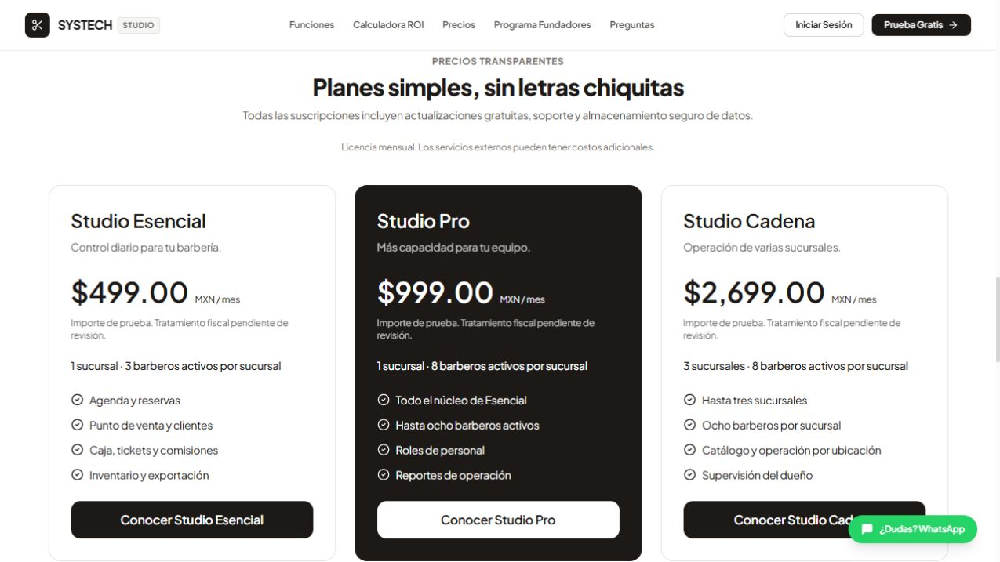
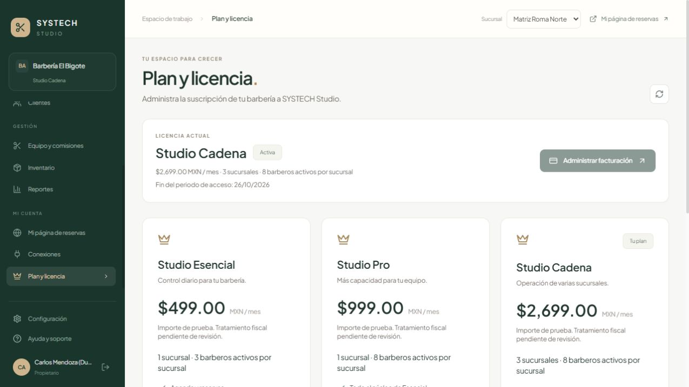

# ST-01 · Catálogo y capacidad de licencia

Sesión: 4 de octubre de 2026, America/Mexico_City. Estado: **En revisión**. Implementación local terminada; no equivale a aprobación del lanzamiento comercial.

## Oferta versionada

Fuente de autoridad: `packages/licensing/catalog.json`, versión `2026-10-04.1`. API, navegador, semilla de demostración y asociación Stripe consumen los mismos códigos. La tabla `Plan` y los límites guardados en `Tenant` se conservan por compatibilidad; los límites efectivos se obtienen del catálogo, aunque una fila antigua diga 999.

| Código compatible | Nombre | Importe mensual de catálogo, MXN | Sucursales | Personal activo por sucursal |
| --- | --- | ---: | ---: | ---: |
| BASICO | Studio Esencial | 499 | 1 | 3 |
| PRO | Studio Pro | 999 | 1 | 8 |
| CADENA | Studio Cadena | 2699 | 3 | 8 |

Fiscalidad configurable y explícita: `PENDIENTE`, `IVA_INCLUIDO` o `MAS_IVA_16`. El valor predeterminado es PENDIENTE y bloquea nuevos checkouts live. Ejemplo técnico: 499 más 16% produce total 578.84; IVA incluido conserva total 499 y desglosa 68.83 de impuesto. Estos cálculos no constituyen una revisión fiscal ni emiten CFDI. Los importes históricos de suscripciones existentes no se sustituyen al consultar el catálogo.

`STRIPE_PRICE_<CODIGO>_TEST` y `STRIPE_PRICE_<CODIGO>_LIVE` están separados para los tres planes. Las variables antiguas sin sufijo solo se admiten fuera de producción. Checkout comprueba importe total, moneda MXN, periodicidad mensual y precio activo; no inventa un precio si falta configuración. Cobro live exige llave live y `LICENSE_FISCAL_REVIEWED=true` con política definida. Promociones live permanecen bloqueadas hasta ST-11.

## Capacidad e historial

- Creación de personal y sucursales, reactivación de personal y restauración de registros eliminados comprueban el plan desde el servidor.
- Un bloqueo transaccional por negocio mantiene la comprobación y el alta en la misma transacción. Dos solicitudes simultáneas disputando la última plaza producen un alta y un rechazo; no dos altas.
- Se cuentan barberos activos y no eliminados, por sucursal. Desactivar libera plaza y conserva identidad e historial.
- Reducir plan con exceso devuelve 409 y no cambia licencia ni borra registros. Después de desactivar el exceso, el cambio conserva todo el personal y registra auditoría.
- Datos antiguos por encima del nuevo catálogo permanecen almacenados; la pantalla avisa del exceso y el servidor impide añadir capacidad. No se migró ni alteró la base de trabajo del usuario.
- No existe importador masivo de personal/sucursales expuesto. Los arrays enviados a la API de altas de personal se rechazan y los campos de capacidad inyectados no conceden plazas. Un futuro importador (ST-26) deberá reutilizar estos controles; no se anuncia como implementado.
- La restauración de sucursal también rechaza personal activo excedente. El flujo completo de baja de sucursal con agenda/caja pendiente se realizará en ST-18.
- El administrador usa el mismo control de reducción. Una suscripción Stripe activa en producción no admite una sustitución local del plan.

## Verificación ejecutada

`npm test`: seis suites aprobadas, 149 comprobaciones: seguridad 42, finanzas/concurrencia 19, integraciones controladas 24, producto 18, base comercial 19 y catálogo/capacidad 27. Se corrigió el evento antiguo de prueba que omitía el plan adquirido; ahora utiliza el código del catálogo. Tras la revisión final de `planId` en webhook, la suite de catálogo volvió a aprobar sus 27 casos sobre la API recompilada.

La suite nueva `scripts/test_license_catalog.js` usa una base SQLite desechable, llamadas HTTP y pruebas simultáneas. Cubre límites 3/8/8 por sucursal, tres sucursales de Cadena, registro, acceso cruzado, reactivación, restauración, rollback de cuenta vinculada, reducción, exceso heredado, planes desconocidos, asociación remota y separación de ambientes. Los casos de checkout usan un proveedor controlado: **no contactan Stripe ni certifican cobro real**. La prueba real sandbox de la sesión anterior sigue registrada por separado en `docs/STRIPE_PRUEBA_VERIFICADA.json`; no se repitió como parte de estas pruebas.

Compilación API aprobada por el runner; compilación web aprobada. Aviso pendiente de rendimiento: bundle principal de aproximadamente 530 kB sin comprimir; optimización en ST-31. Docker incluye ahora el JSON compartido en la imagen final; no se afirma que se haya construido/ejecutado una imagen de producción en esta sesión.

Revisión visual en navegador local, con datos ficticios: tres tarjetas en precios y suscripción; selector de registro; Cadena queda seleccionado al pulsar su tarjeta. Se corrigió la sincronización del formulario, que antes abría login aunque se solicitara registro. El formulario se desplaza dentro del alto de pantalla y exige al menos ocho caracteres como el servidor.

Demostración aislada disponible durante esta sesión: `http://127.0.0.1:5179/app/suscripcion`, API 3102. No incluye conexión Stripe; los botones de cobro indican que falta conectarla. Los servicios previos y la cuenta Stripe del usuario no se modificaron.

## Condiciones y validaciones posteriores

1. ST-04: ejecutar los controles de capacidad y concurrencia con PostgreSQL; demostrar migración/actualización y reversión sobre copia aislada. El SQL de bloqueo está diseñado para ambos motores, pero solo SQLite fue ejecutado aquí.
2. Sinhue y contador: decidir/revisar tratamiento fiscal; ST-15/ST-16 documentan identidad y comprobantes del propio SaaS. No activar la bandera por haber compilado.
3. ST-10/ST-11/ST-16: conectar precios remotos de Cadena y catálogo live, probar cambios/prorrateo/cancelación y promociones con eventos reales. Cambios externos de plan pueden dejar exceso conservado; la gestión completa del portal y conciliación siguen pendientes.
4. ST-18/ST-26: baja de sucursal e importación completa; ST-27/ST-31: revisar todas las promesas de la landing, soporte, contacto real, hardware, accesibilidad y móvil. Esta sesión alineó planes y quitó la oferta vitalicia; no certificó el resto de la página.

Próxima actividad independiente: ST-02, matriz de permisos y aislamiento por sucursal. Participación requerida de Sinhue para esa actividad: revisar la matriz concreta una vez preparada; las decisiones fiscales y contratación de dominio no impiden comenzar la investigación.

## Aclaración de alcance · 5 de octubre de 2026

ST-01 conserva revisión por capacidad en PostgreSQL/ST-04 y la decisión comercial/fiscal. El ciclo completo de Stripe, catálogo live, portal, promociones y cobro de producción se validan en ST-10/ST-11/ST-16; no se exige terminar esas historias para implementar el catálogo de ST-01. Importador y baja de sucursal se validarán cuando sus historias construyan esos recorridos. ST-02 ya tiene implementación y evidencia propia; siguiente trabajo independiente: ST-03.

## Actualización de integración · 7 de octubre de 2026

30 comprobaciones de catálogo/capacidad por motor; requisitos de checkout por plan y ambiente; conservación y concurrencia PostgreSQL verificadas. Regresión actual: 9/9 suites SQLite y 9/9 PostgreSQL. Este resultado actualiza los pendientes técnicos de PostgreSQL descritos en la evidencia histórica anterior. Estado conservado: En revisión. Detalle, límites y capturas en [revisión ST-01 a ST-04](ST01_04_REINTEGRACION.md).

Revisar condiciones comerciales/fiscales; Stripe real permanece en ST-10/ST-16. Importador y baja completa siguen en ST-26/ST-18. Siguiente desarrollo ST-06.
