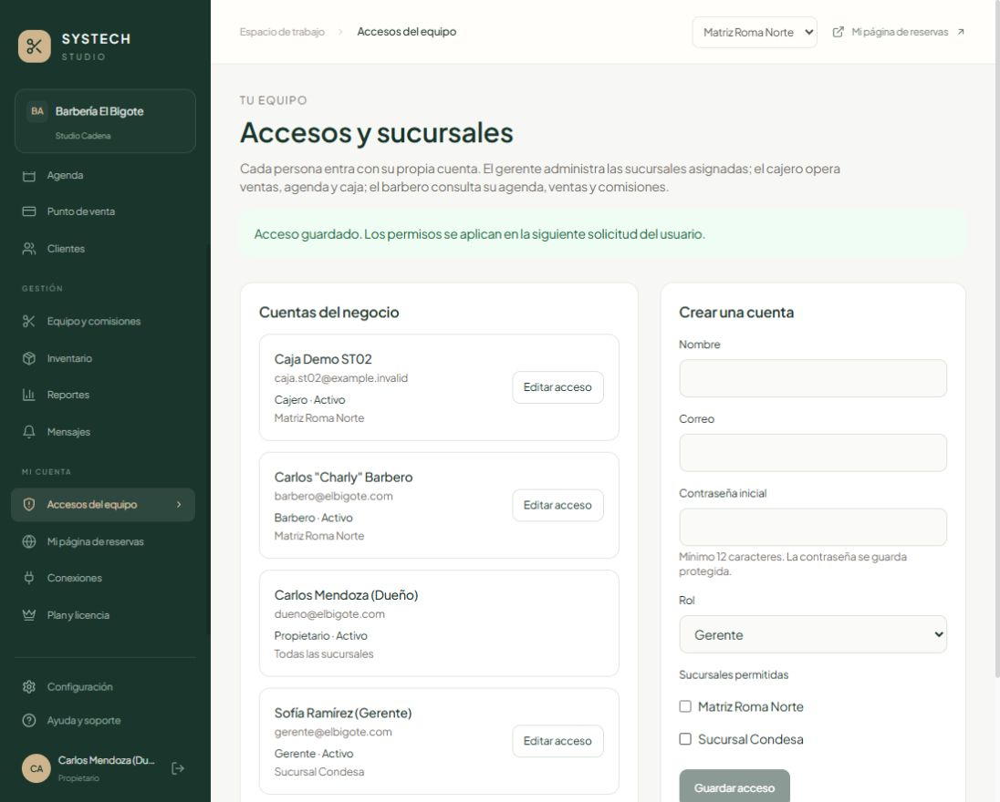
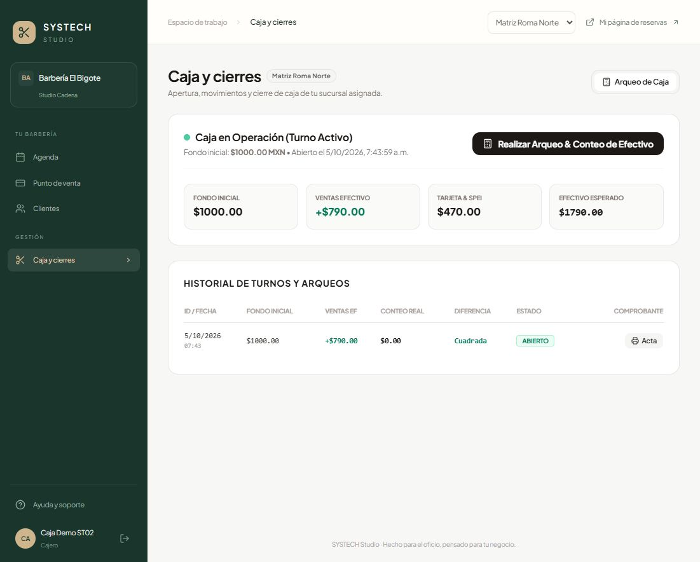
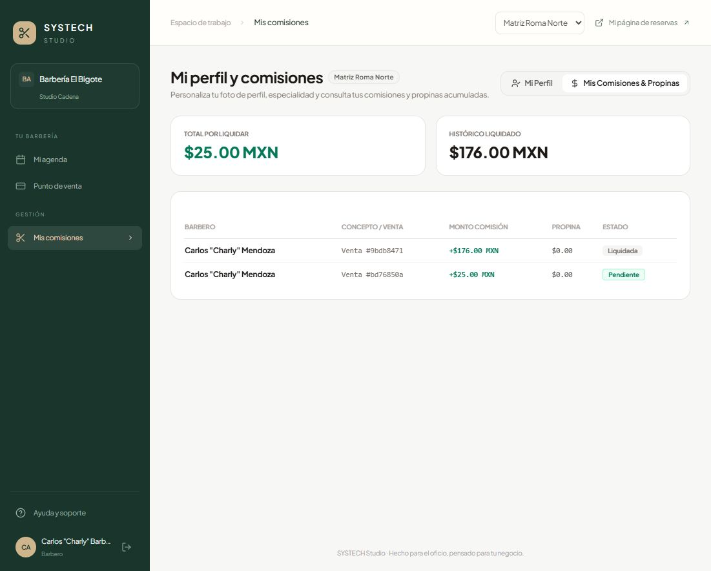

# ST-02 · Aislamiento de negocios y permisos completos

Fecha: 5 de octubre de 2026. Estado: **Implementado y En revisión**. Responsable: Codex. Revisión del alcance de cada rol: Sinhue. [Actividad en Notion](https://app.notion.com/p/3f02035ac0d0819fb631fa823e96f084).

## Resultado y criterios

- [x] Inventario de las 110 rutas montadas, incluidos alias antiguos, archivos y rutas públicas. Las rutas privadas nuevas sin una política expresa se rechazan.
- [x] Pruebas de lectura, cambios, agregados, exportación CSV y comprobantes con dos negocios y dos sucursales por negocio en SQLite aislado. Los IDs ajenos o no asignados no permiten consultar ni cambiar registros.
- [x] El gerente opera solo sucursales asignadas. El barbero ve su perfil, agenda, ventas y comisiones; no ve caja ni ingresos de compañeros. Cambios de permisos, accesos rechazados por la política y excepciones de plataforma tienen auditoría.

Estos criterios tienen evidencia local. Falta la revisión de la matriz por Sinhue y ejecutar la misma regresión con PostgreSQL en ST-04 antes de declarar la historia Validada para producción.

## Trabajo desglosado

| Subtarea | Resultado comprobado |
| --- | --- |
| ST-02.1 Inventariar rutas y definir permisos | Matriz de 110 rutas y archivo JSON contrastados con todos los handlers |
| ST-02.2 Restringir consultas y referencias | Alcance por negocio, sucursal y barbero, incluidos historiales anidados, conteos y transacciones |
| ST-02.3 Proteger comprobantes y entradas públicas | Impresión de 120 segundos ligada a usuario/registro; relaciones de reservas validadas; callbacks de Meta con firma obligatoria |
| ST-02.4 Administrar cuentas del equipo | Pantalla del dueño para crear y cambiar asignaciones; sin elevación a dueño o administrador de plataforma |
| ST-02.5 Ajustar los recorridos de cada rol | Navegación, agenda, POS, clientes y caja coherentes con los permisos de servidor |
| ST-02.6 Probar y documentar | Regresión de siete suites, pruebas cruzadas, compilaciones y revisión en navegador con datos ficticios |

## Matriz para revisar con Sinhue

Todos los roles de un negocio quedan limitados a ese negocio. Una asignación a varias sucursales permite operar esas ubicaciones; elegir una sucursal también limita las consultas que admiten ese filtro.

| Capacidad | Dueño | Gerente | Cajero | Barbero |
| --- | --- | --- | --- | --- |
| Ubicaciones disponibles | Todas del negocio | Asignadas | Asignadas | La de su perfil activo |
| Agenda y venta | Todas | Asignadas | Asignadas | Propias |
| Caja y comprobantes | Todas | Asignadas | Asignadas | Sin acceso |
| Cancelar o devolver ventas | Sí | En asignadas | Sin acceso | Sin acceso |
| Reportes, CSV e inventario | Del negocio | De asignadas | Sin acceso administrativo | Sin acceso |
| Comisiones y liquidación | Todas | De asignadas | Sin acceso | Solo consulta propia |
| Equipo y catálogo local | Sí | En asignadas | Consulta operativa | Solo perfil propio |
| Catálogo común y proveedores | Administrar | Lectura; productos locales editables | Catálogo de venta | Catálogo de venta |
| Clientes | Administrar | Consulta local y alta | Consulta local y alta | Búsqueda de clientes atendidos por él |
| Permisos, licencia, mensajes y configuración del negocio | Administrar | Sin acceso | Sin acceso | Sin acceso |

Los clientes pueden acudir a varias ubicaciones: gerente/cajero ven contactos con origen o historial en sus sucursales; solo reciben historiales permitidos. Se ocultan gasto, visitas y otros acumulados globales para evitar revelar actividad de ubicaciones ajenas. El barbero solo busca contactos con citas o ventas propias. Cambiar notas, membresías o eliminar datos del cliente requiere dueño.

El catálogo común se puede leer para vender; modificar sus precios, stock o contenido requiere dueño. Los bloqueos generales se pueden consultar, pero el barbero solo crea/elimina bloqueos personales. El cajero no administra horarios. La política detallada está en [ST02_MATRIZ_RUTAS.md](ST02_MATRIZ_RUTAS.md); el inventario estructurado está en [ST02_INVENTARIO.json](ST02_INVENTARIO.json).

## Protección aplicada

La API obtiene identidad y asignaciones actuales de la base, verifica que coincidan negocio y rol del token y valida las referencias antes de llamar al handler. El middleware de Prisma limita consultas, agregados y cambios, incluidos listados/conteos relacionados. Las altas validan sus referencias en la entrada; ese middleware no constituye una protección automática para SQL crudo ni para escrituras anidadas futuras. Las rutas públicas, autenticación y procesos programados se revisan por separado.

Cada solicitud autenticada conserva su alcance durante el trabajo asíncrono. Cualquier consulta interna que utilice `requestAccess.run` debe ejecutarse y esperarse dentro de ese contexto: Prisma devuelve consultas diferidas. Las pruebas incluyen solicitudes simultáneas de negocios distintos y relaciones anidadas.

Los tokens de impresión tienen registro, tipo de documento y usuario; caducan a los 120 segundos y comprueban nuevamente usuario activo y asignación vigente. Reasignar sucursales o desactivar una cuenta invalida el acceso siguiente, incluso con una sesión y un token de impresión anteriores. Cambiar el rol exige volver a iniciar sesión. Los comprobantes públicos de citas usan folio público/capacidad, sin aceptar el UUID privado como autorización; un slug de otro negocio se rechaza.

La cuenta de plataforma tiene rutas administrativas explícitas y auditadas, sin permitirle navegar como un dueño mediante un tenant arbitrario. Los trabajos globales manuales de recordatorios/dunning requieren administrador de plataforma. El único SQL crudo de bloqueo de licencia en una ruta privada usa el negocio verificado; no depende del middleware Prisma.

Los POST de Meta, incluidos sus dos alias, requieren `META_APP_SECRET` y la firma `X-Hub-Signature-256` sobre el cuerpo original. Sin configurar ese secreto devuelven 503; con firma ausente/incorrecta devuelven 401. No se envió ningún mensaje ni se configuró una cuenta real. La conexión y asignación de números por barbería siguen en ST-21.

## Verificación ejecutada

Regresión completa: **168 comprobaciones y 7/7 suites aprobadas**: seguridad 42, finanzas/concurrencia 19, integraciones controladas 25, producto 18, base comercial 19, autorización 18 y catálogo/capacidad 27. Las 18 comprobaciones de autorización agrupan múltiples solicitudes y comparaciones por rol/ruta, no equivalen a 18 endpoints. Tras el último ajuste de visibilidad pública se revalidaron sus 18 escenarios y las 110 rutas.

La suite `scripts/test_authorization.js` prueba IDs cruzados, lecturas y cambios, agregados/CSV, historiales compartidos, firmas de Meta, impresión y revocación, lote mixto de comisiones sin cambios parciales, asignaciones incorrectas, perfil no vinculado, administración de cuentas, altas simultáneas para un mismo perfil y separación de contextos concurrentes. Los proveedores se simulan: estas pruebas no certifican entregas o cobros reales.

API y web compilan. La web también aprobó la comprobación de tipos tras ajustar agenda/POS. Permanece el aviso de tamaño del bundle principal (537 kB sin comprimir); optimización prevista en ST-31.

Revisión en navegador con base ficticia: el dueño creó un cajero limitado a Roma Norte; el cajero entró, solo recibió esa sucursal y cargó agenda, POS y caja. No se cambiaron permisos de cuentas reales. Los controles de bloqueo y devolución se ajustaron a los roles permitidos; la autorización del servidor se comprobó además por HTTP directo.

La cuenta ficticia de barbero cargó su agenda, perfil público y tabla de comisiones propias. Su navegación no muestra caja, reportes ni acceso del equipo.

## Actualización de la base local

`scripts/apply_authorization_sqlite.js` añadió solo dos columnas opcionales: `Usuario.sucursalesAsignadasJson` y `ClienteFinal.sucursalOrigenId`. Se creó un respaldo consistente previo en la carpeta temporal, y los conteos de usuarios, clientes y ventas permanecieron iguales. No se ejecutó seed ni se reconstruyeron tablas de la base de trabajo. La API local volvió a iniciar en 3001 y `/api/health` confirmó la conexión a la base.

Una asignación antigua única conserva `sucursalId` mientras el nuevo campo sea nulo. Una asignación expresa vacía deniega acceso. Un barbero necesita un `barberoId` activo explícito: el dueño deberá vincular las cuentas antiguas incompletas desde Accesos del equipo. No se adivina identidad por nombre o correo.

Se preparó la migración PostgreSQL `20261005_authorization`; no se ejecutó contra PostgreSQL. La API de desarrollo se restauró con el scheduler desactivado para evitar envíos durante esta revisión.

## Pendientes y siguiente paso

1. Sinhue: revisar la matriz anterior, especialmente devoluciones reservadas a dueño/gerente y permisos del cajero. Cambios de alcance se implementan y prueban antes de validar.
2. ST-04: migración limpia y actualización de copia con PostgreSQL; ejecutar regresión y recuperación, sin tocar datos comerciales.
3. ST-03: invitación y recuperación por correo, verificación y revocación de sesiones al cambiar contraseña. La cuenta nueva se crea hoy con contraseña inicial; aún no hay invitación enviada.
4. ST-07/ST-21: abuso/concurrencia de reservas y conexión real de mensajería. ST-02 no certifica seguridad completa del producto, operación offline, hardware o conectores reales.

La siguiente implementación independiente es ST-03. Los cobros live y la decisión fiscal pertenecen a sus historias comerciales y no bloquean el trabajo de permisos.

## Actualización de integración · 7 de octubre de 2026

19 escenarios de permisos por motor, 137 rutas; caída de base devuelve 503 sin invalidar sesión; recuperación de carga verificada en navegador. Regresión actual: 9/9 suites SQLite y 9/9 PostgreSQL. Este resultado actualiza los pendientes técnicos de PostgreSQL descritos en la evidencia histórica anterior. Estado conservado: En revisión. Detalle, límites y capturas en [revisión ST-01 a ST-04](ST01_04_REINTEGRACION.md).

Sinhue revisa matriz de roles. PostgreSQL y revocación comprobados; siguiente desarrollo ST-06.
