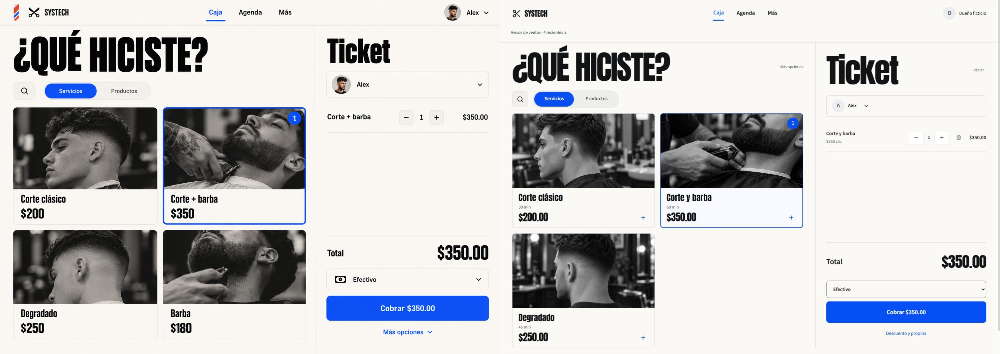
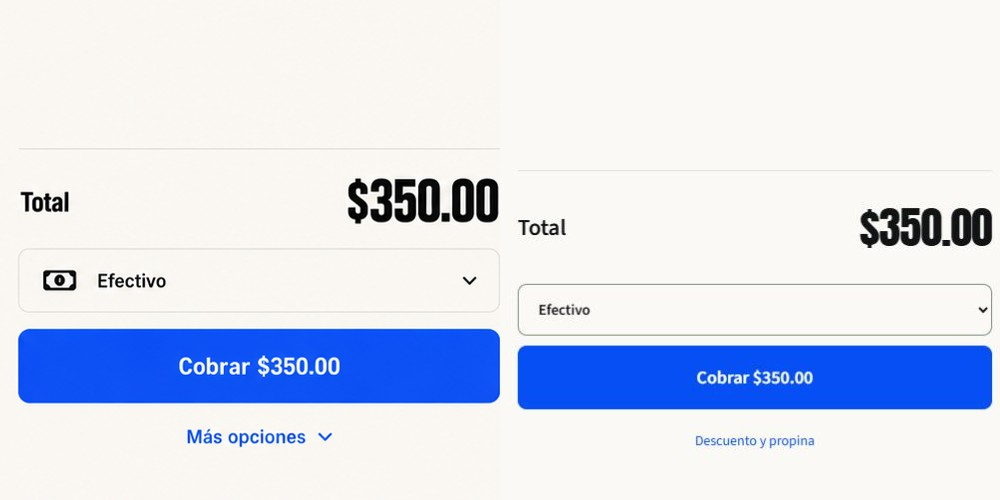
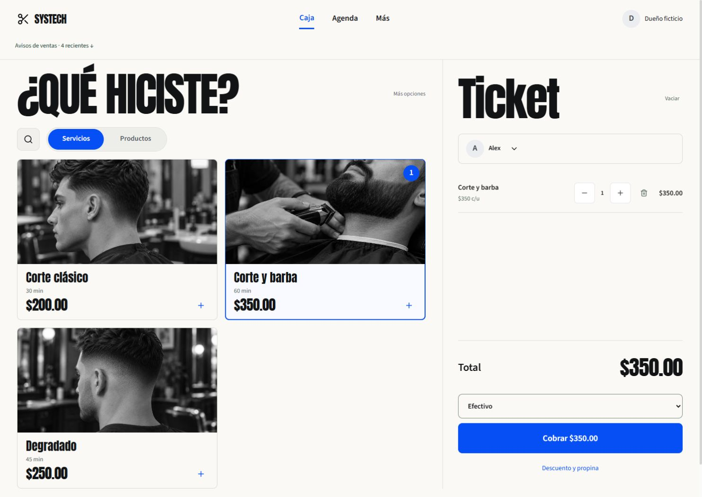
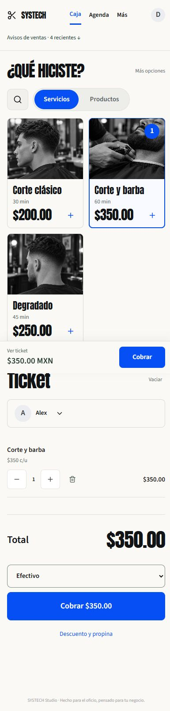

# Caja Silla — implementación de la propuesta elegida

Fecha local: 18 de octubre de 2026.

## Alcance

Se implementó la primera imagen del segundo grupo de propuestas: caja clara, selección azul, fotografías monocromáticas y un ticket enfocado en el total y el pago. La referencia exacta está en referencia.png. No corresponde a la primera propuesta verde, que fue rechazada.

Se reutilizó PosView, la navegación, los permisos y el flujo financiero existentes. La nueva navegación compacta se aplica exclusivamente a /app/pos. Los demás módulos mantienen su presentación. El menú Más conserva sus destinos filtrados por rol, sucursal, búsqueda, ayuda y cuenta.

Se conservaron el catálogo real de la demo (tres servicios), precios profesionales, citas con precios reservados, cliente opcional, inventario, descuentos sujetos a política, propinas, pagos divididos, confirmación y recuperación de operaciones inciertas. No se agregaron servicios ni profesionales para rellenar la imagen. Las imágenes son ejemplos ficticios, no retratos del equipo. La identificación usa iniciales del nombre real registrado.

## Cambios visibles

- Servicios y productos en pestañas separadas; búsqueda y categorías desplegables.
- Servicio seleccionado con borde azul y cantidad visible.
- Fotografías y tipografía locales para no depender de conexiones externas durante la presentación.
- Ticket con controles de cantidad, total y selector de pago; Cobrar abre la confirmación existente.
- Descuento y propina desplegables; valor inicial de propina cero.
- Acceso fijo al ticket y al pago en móvil. El desplazamiento al ticket no modifica el historial del enrutador.
- Los avisos y recuperación financiera continúan visibles en el encabezado, fuera del menú Más.

## Comprobaciones

- TypeScript sin errores.
- Compilación Vite correcta. Se conserva la advertencia de tamaño del paquete principal, aproximadamente 909 kB sin comprimir; no se considera una prueba de rendimiento.
- test_cash_client_ui_helpers.cjs: 12 comprobaciones correctas.
- test_financial_timeout_ui.cjs: 5 comprobaciones correctas.
- test_agenda_price_quote.cjs: 5 comprobaciones correctas.
- test_commercial_ui_helpers.cjs: 5 comprobaciones correctas.
- Recorrido real en navegador: elegir servicio $350; cantidad dos → $700, volver a una → $350; agregar producto $180 → $530; cambiar pestañas conserva el ticket; buscar degradado filtra el catálogo sin cambiar el ticket.
- Propina 15% sobre $350 → $52.50, total $402.50. Volver a 0% restituye $350.
- Confirmación en efectivo: recibir $500 para un total $350 muestra cambio $150. Volver conserva el ticket.
- Pago dividido: selector del ticket abre el diálogo con efectivo $175 y tarjeta $175.
- Móvil 390×844: menú desplazable, cuenta con nombre accesible, ticket y apertura de pago. Ancho del documento igual al viewport, sin desplazamiento horizontal.
- Escritorio: capturas con viewport solicitado 1488×1056; el proveedor devolvió 1483×1052 píxeles. Fuentes e imágenes locales cargadas; sin errores de consola durante la revisión final.
- Revisión independiente de cambios contra las copias de antes: encontró un aviso financiero oculto; se corrigió devolviendo FinancialStatus al encabezado. No detectó otras regresiones nuevas en los contratos financieros revisados.

## Evidencia y comparación

La referencia original mide 1487×1058; se normalizó al tamaño de la captura implementada para la comparación conjunta. Se comparó el mismo estado funcional: Corte y barba seleccionado, cantidad uno, Alex, $350 y efectivo. Las diferencias de nombres, cantidad de servicios y avatar corresponden a datos reales de la demo, no a pérdida de elementos del catálogo.

Otras pruebas visuales: propina-centavos.jpg, pago-dividido.jpg, movil-menu.jpg y movil-ticket-final.jpg.

## Límites

La revisión no registró una venta nueva ni ejecutó devoluciones o movimientos. No se repitió una regresión completa del backend ni pruebas físicas de impresión. No se desplegó a producción ni se conectaron proveedores externos. El cambio queda servido por la demo Docker existente en 127.0.0.1:5197, usando su API actual en 3103; no se cambiaron ni reiniciaron sus datos.

La implementación adapta la propuesta a un producto funcional: conserva avisos de recuperación, duración, centavos y acceso al historial. No es una réplica pixel a pixel. El cambio visual no permite concluir que la conversión o rapidez mejoraron sin pruebas con usuarios.

Las copias previas de los tres archivos modificados y el índice web anterior están en antes/. El frontend nuevo se compila en .tools/pos-silla-build-20261018 y se copia al snapshot ya montado en Docker, conservando las páginas de muestra y los archivos previos.
